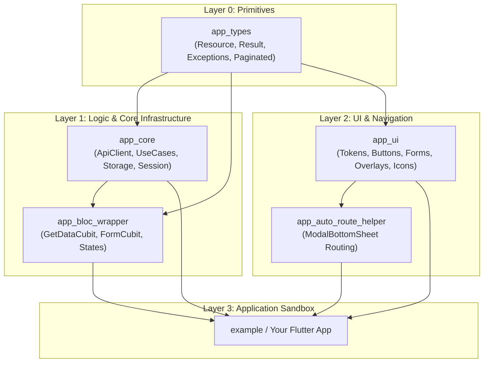

# Flutter Foundation Kit (`flutter_foundation_kit`)

Universal, enterprise-grade shared core and utility packages for Flutter applications, built with Clean Architecture, Melos, and Dart Workspace.

Designed for high-performance mobile and web apps, `flutter_foundation_kit` extracts proven architectural patterns and design systems into modular, decoupled packages that can be consumed together or independently.

---

## Architecture Overview



---

## Packages

| Package | Version | Description | Key Features |
| :--- | :--- | :--- | :--- |
| [`app_types`](packages/app_types) | `0.0.1` | Universal domain primitives and contracts | `Resource<T>`, `Result<T>`, `BaseException`, `Paginated<T>`, `AppFile`, `AppImage` |
| [`app_bloc_wrapper`](packages/app_bloc_wrapper) | `0.0.1` | Generic Cubit state wrappers | `GetDataCubit<T>`, `GetDataCubitWithParams<T, P>`, `FormCubit<T>`, `CubitState<T>` |
| [`app_core`](packages/app_core) | `0.0.1` | Network, storage, and clean architecture base | Backend-agnostic `ApiClient`, `BaseUseCase`, `SecureStorage`, `SessionHandler` |
| [`app_ui`](packages/app_ui) | `0.0.1` | Universal design system and UI components | Color/Typography providers, SVG Icons, AppButtons, Form controls, AppMessenger |
| [`app_auto_route_helper`](packages/app_auto_route_helper) | `0.0.1` | Modal routing helpers for AutoRoute | `ModalBottomSheetAutoRoute`, `ModalDraggableSheet`, `DraggableScrollController` |

> [!NOTE]
> Backward compatibility aliases (e.g. `NTIResource`, `NTIButton`, `NTIInputDecoration`, `NTIRouteHelper`) are included across all packages to facilitate zero-friction migration from legacy monorepos.

---

## Installation via Git Dependency

Add any or all packages directly to your application's `pubspec.yaml`:

```yaml
dependencies:
  # Domain primitives and exceptions
  app_types:
    git:
      url: https://github.com/Ibrahimkayyis/flutter_foundation_kit.git
      path: packages/app_types
      ref: main

  # Generic state management wrappers
  app_bloc_wrapper:
    git:
      url: https://github.com/Ibrahimkayyis/flutter_foundation_kit.git
      path: packages/app_bloc_wrapper
      ref: main

  # Networking, UseCases, and Storage
  app_core:
    git:
      url: https://github.com/Ibrahimkayyis/flutter_foundation_kit.git
      path: packages/app_core
      ref: main

  # Universal design system and widgets
  app_ui:
    git:
      url: https://github.com/Ibrahimkayyis/flutter_foundation_kit.git
      path: packages/app_ui
      ref: main

  # AutoRoute modal bottom sheet integration (Optional)
  app_auto_route_helper:
    git:
      url: https://github.com/Ibrahimkayyis/flutter_foundation_kit.git
      path: packages/app_auto_route_helper
      ref: main
```

---

## Quick Start Guide

### 1. App Initialization & Design System

Wrap your `MaterialApp` with `ColorThemeProvider`, `TyphographyProvider`, and `AppMessengerProvider`:

```dart
import 'package:flutter/material.dart';
import 'package:app_ui/app_ui.dart';

void main() {
  runApp(const MyApp());
}

class MyApp extends StatelessWidget {
  const MyApp({super.key});

  @override
  Widget build(BuildContext context) {
    return ColorThemeProvider(
      initialTheme: colorExample,
      child: Builder(
        builder: (context) {
          return MaterialApp(
            title: 'Foundation App',
            builder: (context, child) {
              return TyphographyProvider(
                typhographyData: typhoGraphy(context),
                child: AppMessengerProvider(
                  child: child ?? const SizedBox(),
                ),
              );
            },
            home: const HomeScreen(),
          );
        },
      ),
    );
  }
}
```

### 2. Networking & Use Cases (`app_core`)

Define typed API endpoints and execute use cases returning `Resource<T>`:

```dart
import 'package:app_types/app_types.dart';
import 'package:app_core/app_core.dart';

// 1. Initialize API Client
final apiClient = ApiClient(
  config: const ApiConfig(
    baseUrl: 'https://api.example.com/v1',
    timeout: Duration(seconds: 15),
  ),
);

// 2. Define clean architecture UseCase
class GetUserProfileUseCase extends BaseUseCase<UserProfile, String> {
  final ApiClient client;
  GetUserProfileUseCase(this.client);

  @override
  Future<Resource<UserProfile>> call(String userId) async {
    final response = await client.get('/users/$userId');
    return response.map(
      onSuccess: (data) => Resource.success(UserProfile.fromJson(data)),
      onError: (err) => Resource.error(err.toException()),
    );
  }
}
```

### 3. Reactive State Management (`app_bloc_wrapper`)

Eliminate boilerplate states and cubits using `GetDataCubit`:

```dart
import 'package:app_types/app_types.dart';
import 'package:app_bloc_wrapper/app_bloc_wrapper.dart';

class ProfileCubit extends GetDataCubit<UserProfile> {
  final GetUserProfileUseCase useCase;
  ProfileCubit(this.useCase);

  @override
  Future<Resource<UserProfile>> usecaseCall() => useCase('user-123');
}

// In your Widget:
BlocBuilder<ProfileCubit, CubitState<UserProfile>>(
  builder: (context, state) {
    return switch (state) {
      CubitLoadingState() => const Center(child: CircularProgressIndicator()),
      CubitSuccessState(:final data) => Text('Hello, ${data.name}'),
      CubitErrorState(:final exception) => Text('Error: ${exception.message}'),
    };
  },
)
```

### 4. Universal UI Components (`app_ui`)

Use contextual typography, colors, responsive buttons, form controls, and snackbars:

```dart
class HomeScreen extends StatelessWidget {
  const HomeScreen({super.key});

  @override
  Widget build(BuildContext context) {
    final text = context.text;
    final colors = context.colorTheme;

    return Scaffold(
      body: Padding(
        padding: const EdgeInsets.all(16),
        child: Column(
          children: [
            Text('Settings', style: text.xl.bold.applyColor(colors.primary10)),
            const SizedBox(height: 16),
            AppTextField(
              title: 'Username',
              hintText: 'Enter your username',
              prefixIcon: const AppIcon(AppIcons.user),
            ),
            const SizedBox(height: 16),
            AppDefaultButton(
              text: 'Save Changes',
              leftIcon: const AppIcon(AppIcons.checkCircle, color: Colors.white),
              onPressed: () {
                context.showSuccessSnackbar('Profile updated successfully!');
              },
            ),
          ],
        ),
      ),
    );
  }
}
```

### 5. Declarative Modal Bottom Sheets (`app_auto_route_helper`)

Register bottom sheets in your `auto_route` routing config:

```dart
@AutoRouterConfig()
class AppRouter extends RootStackRouter {
  @override
  List<AutoRoute> get routes => [
    AutoRoute(page: HomeRoute.page, initial: true),
    ModalBottomSheetAutoRoute(
      page: FilterBottomSheetRoute.page,
      isScrollControlled: true,
      enableDrag: true,
    ),
  ];
}
```

---

## Example Sandbox

An interactive demonstration covering all packages is provided in [`example/`](example/):

```bash
cd example
flutter run
```

---

## Monorepo Development

This repository uses [Melos](https://melos.community) to manage multi-package workflows and automated script execution.

### Prerequisites

- Flutter `3.29.3` or later
- Dart `3.7.0` or later

### Common Commands

```bash
# Bootstrap workspace dependencies across all packages
flutter pub get

# Run all unit and widget tests
dart run melos run test

# Run static analysis across all packages
dart run melos run analyze

# Format all Dart files
dart run melos run format

# Run build_runner code generation
dart run melos run generate
```
